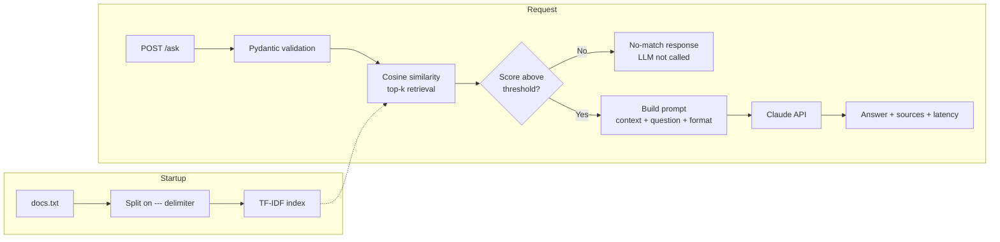

# Cyber Threat Intelligence RAG API

[](https://github.com/Rogersome/llm_cti_project/actions/workflows/ci.yml)

A containerized FastAPI service that answers cybersecurity questions using
retrieval-augmented generation over a MITRE ATT&CK knowledge base. Answers are
grounded in retrieved passages and returned with their sources so they can be
verified.

## Why this exists

General-purpose LLMs hallucinate on security questions and have no knowledge of
an organization's own threat intelligence. This service restricts the model to a
curated knowledge base, returns the passages each answer is based on, and
declines to answer when nothing relevant is retrieved.

## Architecture



## Quick start

```bash
git clone https://github.com/Rogersome/llm_cti_project.git
cd llm_cti_project
cp .env.example .env        # add your ANTHROPIC_API_KEY
docker compose up -d
curl http://localhost:8000/health
```

Interactive API docs: <http://localhost:8000/docs>

## API

### `GET /health`

```json
{ "status": "ok", "documents_loaded": 6 }
```

### `POST /ask`

```bash
curl -X POST http://localhost:8000/ask \
  -H "Content-Type: application/json" \
  -d '{"question": "how do attackers use powershell"}'
```

```json
{
  "answer": "## Summary\nAttackers abuse PowerShell as a command and scripting interpreter...",
  "sources": [
    {
      "rank": 1,
      "score": 0.2853,
      "excerpt": "MITRE ATT&CK T1059: Command and Scripting Interpreter..."
    }
  ],
  "model": "claude-haiku-4-5",
  "latency_ms": 2190
}
```

| Status | Meaning |
| --- | --- |
| 200 | Answer returned, or no relevant passage found |
| 422 | Question failed validation (too short or too long) |
| 502 | Upstream LLM error |
| 504 | Upstream LLM timeout |

## Design decisions

**Index built once at startup.** The TF-IDF matrix is computed in the FastAPI
lifespan handler and reused across requests, so per-request work is limited to
transforming the query.

**Similarity threshold before calling the LLM.** If no passage clears the
threshold, the service returns a no-match response without an API call. This
prevents the model from answering off-topic questions from its own knowledge and
avoids paying for calls that cannot produce a grounded answer.

**Sources attached by the application, not the model.** Retrieved passages are
returned alongside the answer, so citations cannot be fabricated.

**Knowledge base split on an explicit `---` delimiter.** An earlier version split
on blank lines, which broke each ATT&CK technique into fragments and stripped the
context from retrieved passages.

**Secrets injected at runtime.** Configuration is read from environment
variables; `.env` is excluded from both version control and the Docker image, and
`.env.example` contains placeholders only.

**Container runs as a non-root user** with a healthcheck against `/health`, and
dependencies are installed before application code is copied so that image layers
are cached across source changes.

## Testing

```bash
pip install -r requirements.txt
export ANTHROPIC_API_KEY=test-key
pytest -v
```

The Anthropic client is mocked, so tests make no network calls. Two of the four
tests assert that the LLM is **not** called — for failed validation and for
retrieval below the threshold — because the cost-control path matters as much as
the happy path.

## CI/CD

GitHub Actions runs on every push and pull request:

1. **test** — install dependencies on Python 3.12 and run the test suite
2. **docker** — build the image with layer caching, gated on the test job passing

## Project structure
app/
config.py environment-based settings
schemas.py request and response models
service.py retrieval, prompt assembly, LLM call
main.py FastAPI app, lifespan, error handling
src/rag.py TF-IDF retrieval module
data/docs.txt MITRE ATT&CK knowledge base
tests/ mocked API tests
## Known limitations and next steps

- **TF-IDF matches on surface terms only.** Synonyms and mixed-language queries
  are missed. Next step: swap in an embedding model and a vector store behind the
  same retrieval interface.
- **No retrieval evaluation.** A labelled question set is needed to measure
  whether the correct passage is retrieved, rather than judging by inspection.
- **Single-process, in-memory index.** Fine for this corpus size; a larger
  knowledge base would need a persistent vector store.
- **No streaming.** Responses are returned after the full generation completes.
- **Not an agent.** The flow is fixed. Adding tool calling (for example, live CVE
  lookups) is the natural extension.

## Stack

Python 3.12 · FastAPI · scikit-learn · Anthropic Claude API · Docker · GitHub Actions
